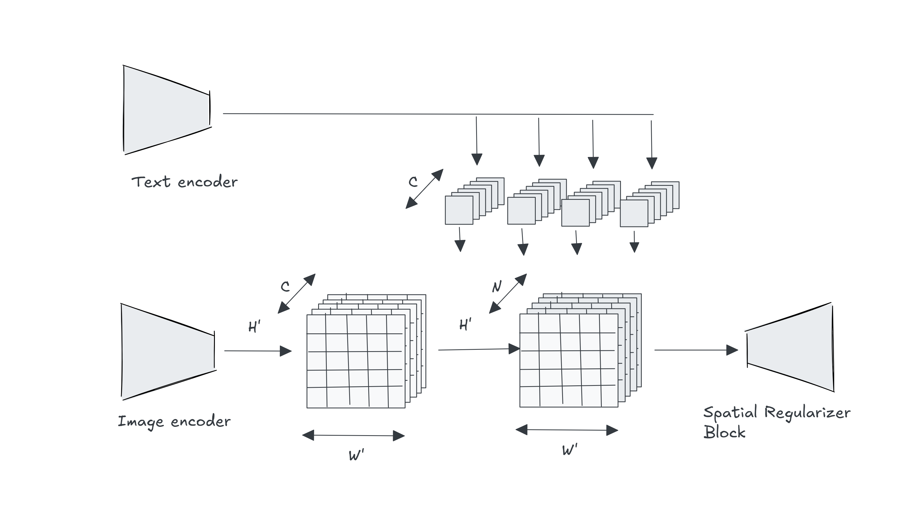
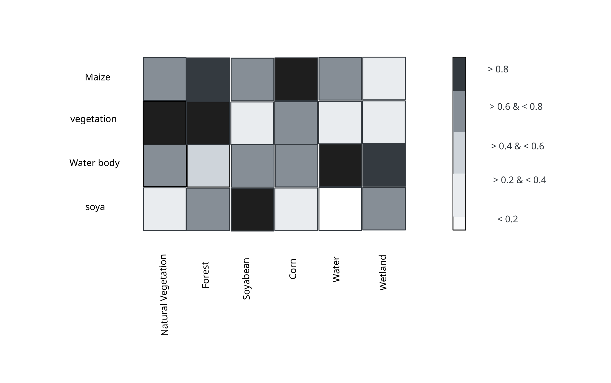
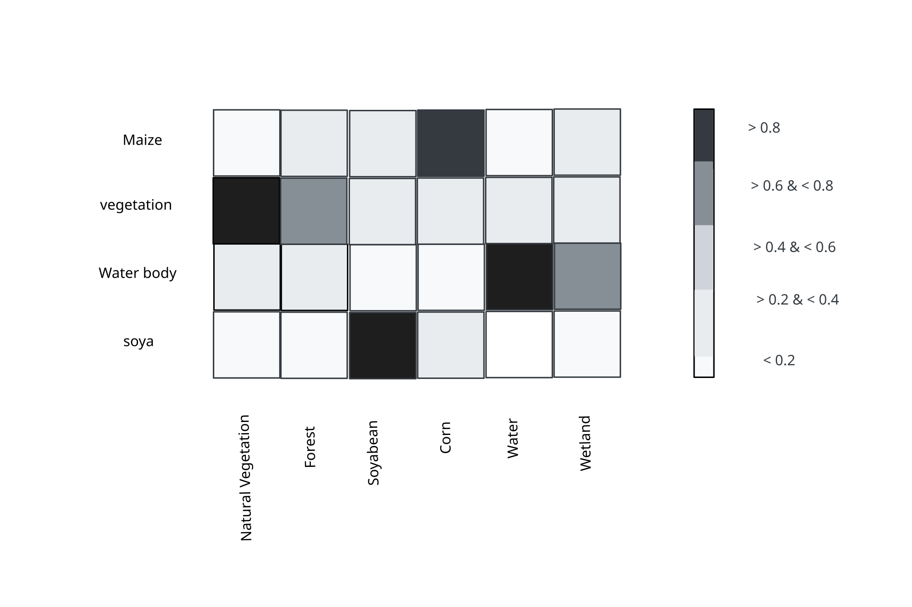

# Introduction

*In* this Blog, I will discuss the LSeg (Language-driven Semantic Segmentation) paper. In recent years, semantic segmentation has gained significant traction in computer vision. Incorporating natural language adds another layer of complexity—especially when asking a model to predict unseen classes, a key limitation of traditional architectures. LSeg addresses these exact challenges.

While few-shot learning approaches exist, they still require labeled training samples for new classes. In contrast, the authors focus on zero-shot learning. By leveraging language embeddings, LSeg can identify both seen and unseen classes without additional labeled data. Inspired by CLIP’s strong zero-shot capabilities, the authors adapt this concept to dense prediction tasks.

# Main Idea

The authors' core approach is to map both image pixels and text labels into a shared embedding space, allowing the model to assign a semantic label to every single pixel.

#### **Text Encoder**:

The text encoder embeds $N$ potential labels into a continuous vector space $R^C$. To accomplish this, the authors utilize CLIP's pretrained text encoder.

<Math
  expression="T_1, \dots, T_n \in R^C
"
/>

#### **Image Encoder:**

Similar to the text encoder, the image encoder generates a dense embedding vector for every pixel. The authors use Dense Prediction Transformers (DPT) for this component. Given an image of size $H \times W$ and a downsampling factor $s$ <InlineMath expression="\tilde{H} =  \frac{H}{s},   \tilde{W} =  \frac{W}{s}" />\
&#x20;the model outputs dense feature embeddings of shape   <InlineMath expression="I \in R^{\tilde{H} \times \tilde{W} \times C}" />

#### **Word-Pixel Correlation Tensor:**

Once the image and text features are embedded, the model computes their correlation using a dot product (or cosine similarity). It will create tensor of size <InlineMath expression="\tilde{H} \times \tilde{W} \times N" /> defined as&#x20;

<Math
  expression="f_{ijk} = I_{ij} \cdot T_k
\\[25pt]
where ~ I_{ij} \in R^{\tilde{H} \times \tilde{W} \times C}
~~~~~~
T_k \in R^{C \times N}
"
/>

For  N = 1, embedding size of Image $$I\_ij $$ and Text $T\_K$

<Math
  expression=" T_k \in R^C 
\\
I_{ij} \in R^C
"
/>

Below is the pixelwise softmax

<Math
  expression="% Requires \usepackage{amsmath} in your preamble for \text{}
y_{ij} = \text{softmax}\left(\frac{f_{ij}}{t}\right) = \frac{\exp\left(\frac{f_{ij}}{t}\right)}{\sum_{i=1}^{H} \sum_{j=1}^{W} \exp\left(\frac{f_{ij}}{t}\right)}

\\[10pt]

t: Temperature
"
/>

During training, LSeg minimizes the standard spatial cross-entropy loss across all pixels, encouraging the model to align visual pixel representations directly with their corresponding text label embeddings.

#### Spatial Regularizer Block:

To address memory constraints during training and inference, the authors introduce two spatial-text fusion blocks:

* **DepthwiseBlock:** Applies depthwise convolutions followed by a non-linear activation to efficiently fuse text and image representations.
* **BottleneckBlock:** Further enhances the depthwise convolutions by incorporating the output of a max-pooling operation over the set of text labels, capturing the most prominent label interactions.

Finally, a bilinear upsampling block restores the spatial feature maps from <InlineMath expression="\frac{H}{s} \times \frac{W}{s}" /> back to the original image dimensions ($H \times W$), yielding high-resolution pixel-level predictions.

# My Implementation

Unlike standard zero-shot setups, my objective was supervised remote sensing segmentation using a lightweight foundation model (`prithvi_eo_v2_tiny_tl`) aligned with a pretrained CLIP text encoder.

**Methodology Highlights:**

* **Decoder Modification:** Kept Prithvi's spatial decoder, removed the default classification head, and added a projection layer to map dense spatial features into the text embedding space. An encoder-only baseline yielded low-resolution, "blobby" segmentations; retaining the decoder restored finer spatial boundary definition.
* **Pixel-Text Alignment:** Evaluated dot-product similarity between projected spatial features and text embeddings, applying a pixel-wise softmax to derive output class probabilities.
* **Fine-Tuning:** Trained for \~12 epochs using a 300-image subset of the Prithvi dataset.
* **Prompt Engineering:** Applied mean centering to neutralize class biases and prompt templating (e.g., *"remote sensing view of \[class]"*) to enrich text feature representations.

### Key Improvements Made

**Heatmap matrix showing pre-mean-centering cosine similarity scores between fixed dataset target classes (x-axis) and prompt vocabulary terms (y-axis).**

**Heatmap matrix showing post-mean-centering cosine similarity scores between fixed dataset target classes (x-axis) and prompt vocabulary terms (y-axis).**

# Limitation

While LSeg provides an elegant baseline for language-guided segmentation, several practical limitations emerged during experimentation on remote sensing data:

1. **Prompt Complexity Ceiling:** The text-image correlation mechanism degrades when exposed to lengthy or multi-attribute text prompts. While basic action prompts (e.g., *"detect water"*) yield clear similarity maps, long-form natural language prompts degrade segmentation precision.
2. **Domain-Specific Vocabulary Drift:** The model's performance drops when encountering out-of-vocabulary spatial features. Satellite imagery presents intricate spatial textures, non-standard orientations, and multi-spectral signals that are far more challenging to align with text embeddings than standard RGB natural images.

> 🔗 Check [demo app](https://vlmsatellitesegmentation-hktm3u6yygaeh4hohbjdnb.streamlit.app/)  and [code](https://github.com/leamandeep/vlm_satellite_segmentation)
