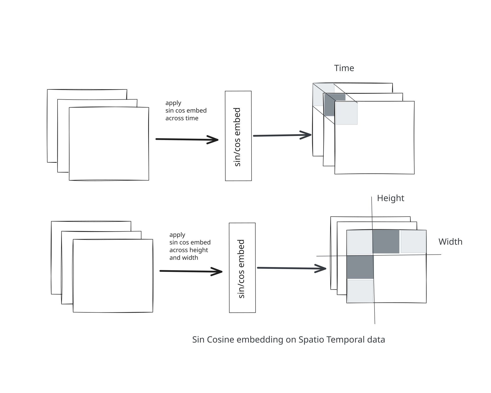
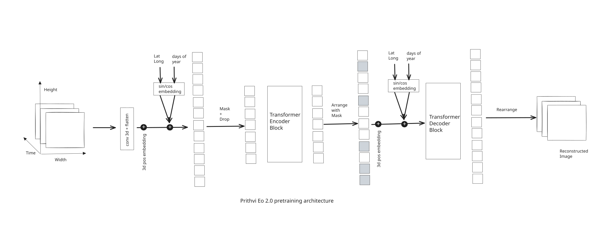

## **Introduction**

*In* this blog, I will discuss the research paper **Prithvi-EO 2.0: A Versatile Multi-Temporal Earth Geospatial Foundation Model**. In recent years, a lot of geospatial foundation models have been introduced in EO, claiming to solve various EO problems. A foundation model is a general-purpose model that is trained on massive datasets and can be fine-tuned for many downstream tasks.

In this paper, the authors mention three limitations of available models. First, these models are either good at spatial or temporal learning. Most of these models are not capable of handling both modalities at the same time. If they are good at capturing long-range dependencies, they may not be able to handle larger areas, and vice versa. EO observation data are spatiotemporal in nature. We need both aspects of the data to understand changes.

Second, most of the evaluations done on these models were not performed on diverse tasks, so clear comparisons were limited. Third, adapting GFMs for EO tasks is challenging and may require a certain level of AI expertise.

## **The main idea**

*In* Prithvi, the researchers used a ViT model. They replaced the 2D patch embedding and 2D positional encoding with 3D patch embedding and 1D positional encoding (sin/cosine encoding). The 3D input consists of (t), (h), and (w) dimensions. The 1D positional encoding is defined as:

<InlineMath expression="PE_{(pos, 2i)} = \sin\left(\frac{pos}{10000^{\frac{2i}{d_{\text{model}}}}}\right)" />

<InlineMath expression="PE_{(pos, 2i+1)} = \cos\left(\frac{pos}{10000^{\frac{2i}{d_{\text{model}}}}}\right)" />

They also encoded metadata such as latitude, longitude, and the day of the year, and added it to the embedding token using a weighted sum of learned weights. Since latitude, longitude, and day-of-the-year information can be missing from the data, the authors simulate such situations by randomly dropping either temporal or geolocation information while masking image patches. Attention is applied across both spatial and temporal dimensions. So, it is able to handle both modalities at different scales.&#x20;

Prithvi was scaled to 600M parameters, placing it among the largest models for EO tasks. MAE is used for pretraining. Prithvi was trained on a 4.2 million global time-series dataset.

Prithvi used a stratified and diversity-oriented sampling strategy to create a globally representative training dataset. The authors selected HLS tiles based on **land-use/land-cover (LULC) diversity, ecoregions, and spatial heterogeneity**. They sampled tiles representing different LULC classes, specifically increasing the sampling of **urban areas**, and included tiles with high LULC entropy to capture heterogeneous landscapes. They also ensured broad **ecoregional coverage**.

For each selected location, they constructed **four-image temporal sequences**, with observations separated by approximately **1–6 months**, allowing the model to learn seasonal and temporal changes. These sequences were divided into **256 × 256 pixel patches**. Cloudy and poor-quality samples were filtered out, while spatial overrepresentation was controlled. This produced about **4.2 million training samples** and **45,568 validation samples**.

## Limitation

The authors mentioned that as the number of timestamps increases, the computational complexity also increases. The attention mechanism used in Prithvi has quadratic complexity by nature.

Satellite images are not continuous by nature. We also have the issue of cloud pixels. I feel this limitation is present in the model, but it is not solving the missing-frames problem. I did not find a detailed discussion of this issue in the paper.
