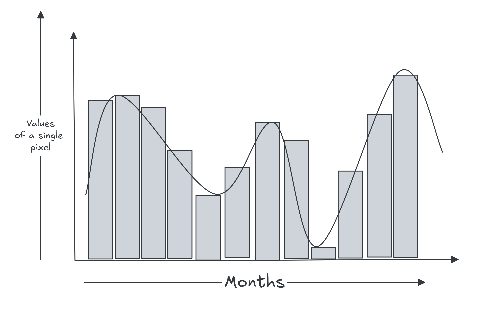
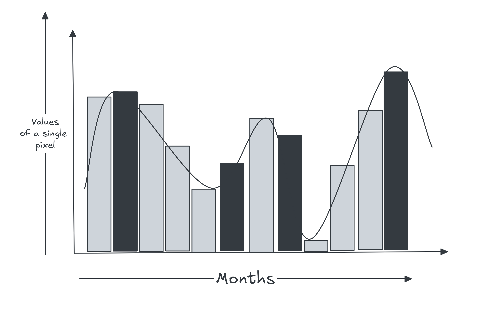

# Introduction

*C*rop mapping is one of the most critical recurring challenges in agricultural remote sensing. The task quickly becomes complex when scaling across large geographic areas or working with scarce ground-truth labels. While specialists often rely on spectral libraries to address label scarcity, this approach comes with significant operational limitations. In this post, I explore how modern computer vision and deep learning techniques provide a more robust, scalable solution.

# Main Idea

*E*very crop has its own spectral and temporal signature, which can be observed through satellite imagery, whether optical or microwave remote sensing. However, these signatures are not always consistent. They can vary depending on geographical location, climatic conditions, crop growth stages, agricultural practices, and several other factors.

Traditionally, agricultural specialists collect ground-truth data through field surveys to identify and label different crops. While this approach provides valuable information, collecting annotations over large geographical areas can be time-consuming and expensive. Scale becomes an important challenge, especially when working with satellite imagery across multiple regions.

This led me to explore a different approach.

The idea was to use satellite imagery from Sentinel-1 and Sentinel-2 to identify patterns in crop signatures. Instead of manually defining every crop category based on fixed rules or thresholds, what if we could train a model to learn these patterns and group similar signatures together?

To explore this, I developed a model that converts satellite observations into a set of learned representations. In simple terms, the model tries to identify similarities between different crop signals and organize them into groups based on their underlying characteristics.

However, learning these representations is only one part of the problem. Different crops can sometimes exhibit similar signatures, while the same crop may behave differently across regions. Naturally, the model will not always group them correctly.

This is where the annotation workflow comes into play.

Rather than treating the initial predictions as final, I wanted to make the framework flexible enough for users to correct its mistakes. If the model struggles to distinguish crops in a particular area, users can provide additional labels or refine existing annotations. These examples can then be used to fine-tune the model, helping it learn from its mistakes and improve its predictions.

Another challenge is missing satellite observations, particularly in optical imagery, where cloud cover can create gaps in the temporal data. Since crop identification depends heavily on how vegetation changes throughout its growing season, missing observations can make classification difficult. The framework is designed to work with incomplete observations, allowing the model to use the available information to predict crop categories.

The goal of this experiment was not simply to build another crop classification model. I wanted to explore whether we could make crop annotation more adaptable by combining learned satellite representations with human feedback, reducing the amount of manual labeling required while allowing the model to improve over time.

# Current Limitation

Although the framework has shown promising results, there are still a few limitations that need to be addressed.

* **Lack of multimodal support:** Currently, the model does not support multiple satellite data sources together. Combining optical imagery from Sentinel-2 with SAR observations from Sentinel-1 could help the model better understand crop characteristics, especially under cloudy conditions.
* **Seasonal crop confusion:** Crops such as winter paddy and monsoon paddy need to be handled carefully. Although they belong to the same crop category, their growing seasons and temporal patterns differ. Without properly accounting for these differences, the model may struggle to distinguish them or group them incorrectly.
* **Still experimental:** The framework is still in its experimental stage. There is plenty of room for improvement, particularly in how the model learns crop representations and adapts to different regions. For now, the idea is to keep experimenting, identify what works and what doesn't, and improve it along the way.
